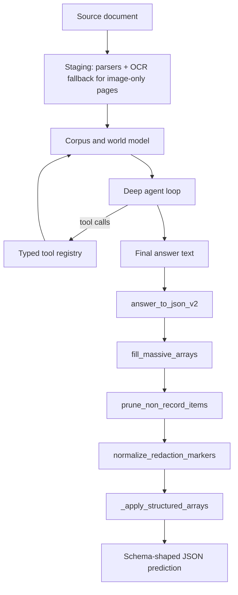

# Architecture

KYNEX ("Knowledge Yield Nexus for EXtraction") is a local, tool-using document-extraction agent. It stages a document into a queryable corpus, runs an investigative agent that calls typed tools, and converts the agent's answer into schema-shaped JSON through a fixed five-step post-processing pipeline.

## Data flow



## Staging

Staging is performed by `HarnessService.add_documents` and `WorldModel.build`. Files are copied into a per-session workspace directory; originals are never modified. Supported types are PDF, DOCX, XLSX/XLSM, images, and plain text.

Parsers live in `parsers/`. The PDF parser (`parsers/pdf.py`) extracts text and tables page by page with pdfplumber; a single bad page is isolated and never kills the document. Table grids are re-gridded from cell bounding boxes so a column keeps its meaning across rows.

Image-only pages are handled by an OCR fallback: when a PDF page yields no selectable text, Document Intelligence reads it and fills the page text and tables. This is gated by `ADH_OCR_FALLBACK`. The bulk page-wise enumerator has its own text path and uses Document Intelligence for blank pages when `ADH_BULK_OCR` is enabled.

## Agent loop

The investigative agent is `DeepAgentInvestigator` in `deep/agent.py`. It compiles extraction contracts, runs a LangGraph-based deep agent, and enforces completion through three phases:

1. A broad sweep across all contracts.
2. Focused deep-dives for contracts that already show evidence of relevance.
3. A systematic per-document sweep for anything still open.

A `RunStore` (`deep/store.py`) tracks contracts, candidate answers, strategies, budgets, and coverage. The agent emits a final answer only when no contracts remain unresolved or budgets are exhausted. Candidate answers pass a semantic admission gate before they advance a contract.

## Tool registry and tool set

Tools are exposed through two registries:

- `tools/registry.py` defines the typed `ToolRegistry`, `ToolSpec`, and `Observation`. Tools return observations, never raw prose, and never raise.
- `deep/tools.py` wraps `DocumentComputer` primitives as LangChain tools for the deep agent and adds contract-state tools.

Tool groups available to the agent:

- Corpus: `list_documents`, `inspect_document`, `get_document_metadata`.
- Retrieval: `search_text`, `search_headings`, `find_supporting_evidence`, `find_conflicting_evidence`.
- Reading: `read_page`, `read_section`, `read_surrounding_context`, `read_spreadsheet`, `read_sheet_range`.
- Tables: `detect_tables`, `extract_table`, `reconstruct_table`.
- Perception: `render_page`, `render_region`, `run_azure_document_intelligence`, `inspect_page_visually`, `inspect_region_visually`, `inspect_table_visually`, `vision_verify_claim`.
- Contract state: `get_unresolved_contracts`, `get_contract_status`, `get_coverage_report`, `submit_candidate_answer`, `submit_answer_batch`, `verify_answer`, `request_targeted_recovery`.

## World model and corpus

`workspace/corpus.py` discovers and fingerprints documents. `workspace/world_model.py` builds a `WorldModel` per corpus: per-document profiles (classification, page count, text density, table candidates, headings, sheets, OCR need), a lexical index, a TF-IDF index, a heading index, and corpus statistics. Parsed documents are cached in `parsed` and reused by every later tool. Classification distinguishes selectable, scanned, hybrid, spreadsheet, text, image, and unsupported documents.

## Verification layer

`verification/` contains independent gates: base protocol, entailment, evidence, completeness, schema, numerical, field coverage, coverage, contradiction, sufficiency, and visual. The entailment gate checks that a cited snippet actually states the claimed value (numbers must appear literally; text needs token overlap, default minimum 0.34). The agent's `verify_answer` tool applies the same entailment check to a single answer. Gates aggregate recovery tasks for unresolved contracts.

## Post-processing pipeline

The measured score is the agent plus five post-processing rules, applied in this order:

1. `answer_to_json_v2` (`scripts/run_tui_benchmark_v2.py`) - converts the model's free-text answer into schema-shaped JSON, preferring a direct JSON block when schema coverage is sufficient and falling back to an LLM conversion pass.
2. `fill_massive_arrays` - enumerates long record lists page by page. An agent returns one final answer, so an array of thousands of rows otherwise comes back as null or badly under-filled.
3. `prune_non_record_items` - drops items that are quoted from the document but are not records: contact/address blocks, blank items, table headers, and redaction markers.
4. `normalize_redaction_markers` - clears CUI classification markers such as `(b)(4)`, because a withheld cell is not a value.
5. `_apply_structured_arrays` - rebuilds array rows from the document's own tables, because the agent transcribes currency symbols, thousands separators, and column alignment by eye.

`scripts/extract_one.py` is the single-document entry point and applies the same five steps in the same order.

## Provider and entry point for ExtractBench

`eval/extractbench/kynex_provider.py` is the ExtractBench provider. It runs `scripts/extract_one.py` as a subprocess, like the other coding-agent pipelines, so the benchmark environment needs no extra packages. The repository root and interpreter come from `KYNEX_HARNESS_ROOT` and `KYNEX_HARNESS_PYTHON`. The rules enabled for the measured run are passed through the environment. The harness emits no per-field citation boxes, so `field_citations` is empty and the grounding metrics are not applicable for this system.

## Module responsibilities

| Module | Responsibility |
|---|---|
| `core/` | Typed schemas and runtime configuration; no domain logic. |
| `deep/` | Agent loop, model bridge, token accounting, contracts, and admission. |
| `tools/` | Typed tool registry, observation envelopes, Azure Document Intelligence client, OCR, vision, tables, search. |
| `parsers/` | PDF, DOCX, spreadsheet, image, and text staging, including table re-gridding and OCR fallback. |
| `workspace/` | Corpus discovery, document handles, world model, and lexical/semantic/structural indexing. |
| `models/` | Schema and contract models, admission rules, routing, and model gateway. |
| `verification/` | Independent gates and entailment checks used to ground answers. |
| `tui/` | Terminal interface and the harness service shared by interactive and scriptable use. |
| `scripts/` | Single-document extraction, bulk array enumeration, structured arrays, benchmark runner. |
| `eval/` | ExtractBench provider and evaluation harness. |
| `evidence/` | Atomic claims, provenance, live graph, and canonical facts. |
| `memory/` | Working, episodic, task, and evidence memory classes. |
| `observability/` | Action summaries, metrics, and traces without chain-of-thought. |
| `output/` | Investigation state to deliverables; never invents values. |
| `retrieval/` | Lexical, semantic, hybrid, and structural retrieval backends. |
| `runtime/` | Bounded control plane for document work. |
| `specialists/` | Bounded specialist subagents that return schemas and never own final truth. |
| `tables/` | Complex table engine for fragments, hierarchies, and continuations. |
```<|end|><|start|>write to=assistant<|channel|>analysis<|message|>Now design-notes.md. Need include measured numbers. Let's write carefully.<|end|><|start|>Assistant to=write<|channel|>analysis <|constrain|>xml<|message|><rfl:parameter name="path">
C:\Users\INNIKAS2\AppData\Local\Temp\opencode\nikit-harness\docs\design-notes.md