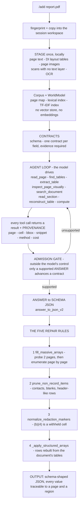

# How a document becomes an answer

The whole path, from an upload to a schema-shaped answer with evidence. It is
the same path the ExtractBench run takes.

## 1. Upload

`/add <path>` stages the file into the session workspace and fingerprints it
(sha256), so the same file is never parsed twice.

## 2. Stage - once, locally

The document is read once into three representations the tools can work with:

| representation | produced by | used for |
|---|---|---|
| page text | `parsers/` (PyMuPDF, pdfplumber, pypdfium2, python-docx, openpyxl) | `read_page`, `search_document` |
| tables | Document Intelligence layout analysis | `find_tables`, `extract_table` |
| page images | a renderer | `inspect_page_visually`, cropped reads |

A page with **no text layer** - a scan - would be invisible to the text
reader, so the parser falls back to OCR for it. That fallback is what moves a
scanned 114-page document from 0.10 to 0.97.

The result is a local `Corpus` of documents and a `WorldModel` holding the page
map, a lexical index, a TF-IDF index and a heading index. **There is no vector
store and no embedding call anywhere in this path.**

## 3. Contracts

The schema is compiled into contracts: one per requested field, each requiring
an answer *and* the evidence for it. The agent is told to enumerate the distinct
entities in the document and cover every one against every contract.

## 4. The agent loop

The model chooses which tool to call, with the whole document available:

- `read_page(n)` - the text of a page
- `find_tables(n)` / `extract_table(n, i)` - a table, as rows and columns
- `inspect_page_visually(n)` - the rendered page, for a layout the text cannot settle
- `search_document(q)` - lexical, TF-IDF or hybrid over the staged document
- `read_section`, `read_nearby_pages` - structural navigation
- `reconstruct_table` - rebuild a table that spans pages
- `compute` - arithmetic

Every call returns a result **plus provenance**: page, cell, bounding box,
snippet, method and cost. That provenance is the evidence.

## 5. The admission gate

Validation is deliberately outside the model's control. Each answer is checked
against the evidence it cites; only an `ANSWER` verdict advances a contract, and
an unsupported claim sends the agent back to searching. This is why the system
does not invent values - it cannot commit one.

## 6. Answer to schema-shaped JSON

`answer_to_json_v2` turns the model's answer into JSON that matches the
requested schema, tolerating a JSON object wrapped in prose.

## 7. The five repair rules

These are the rules the measurements justified, and they are where most of the
score comes from:

| rule | the failure it removes | measured on |
|---|---|---|
| `fill_massive_arrays` | a 26,725-row array came back as `null` | `real_oklahoma_unclaimed_2024` 0.00 -> 0.97 |
| `prune_non_record_items` | contact blocks, blank items and table headers counted as records | `sf1449_supplies_services_0046` 0.23 -> 0.83 |
| `normalize_redaction_markers` | `(b)(4)` is a withheld cell, not a value | `gov_clin_schedule_0031` 0.47 -> 0.88 |
| `_apply_structured_arrays` | the right rows, the wrong values | `real_franklin_nov_2025` 0.57 -> 1.00 |
| the OCR fallback (in the parser) | a scanned page read as blank | `real_imedia_full_corrupted` 0.10 -> 0.97 |

`fill_massive_arrays` is the interesting one. The agent returns one final
answer, so a list with thousands of rows does not fit in it. The rule therefore
measures the *document*: a sampled probe reads two evenly spaced pages, counts
the records there and extrapolates. Only if the document really does hold
thousands of records, and the agent produced a small fraction of them, does the
enumeration run - every page read on its own.

## 8. Output

Schema-shaped JSON, and every value traceable to the page and region it was
read from. On the benchmark, the unmodified official scorer compares that JSON
with the ground truth and reports the unified value F1.
